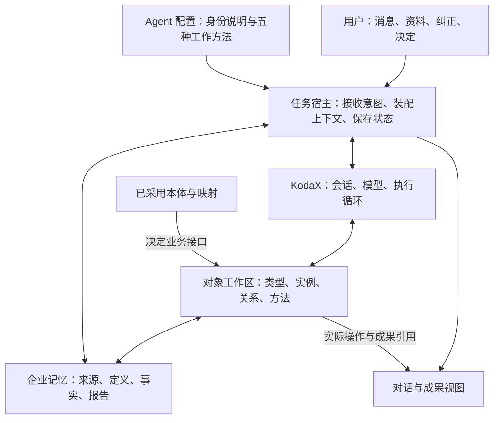
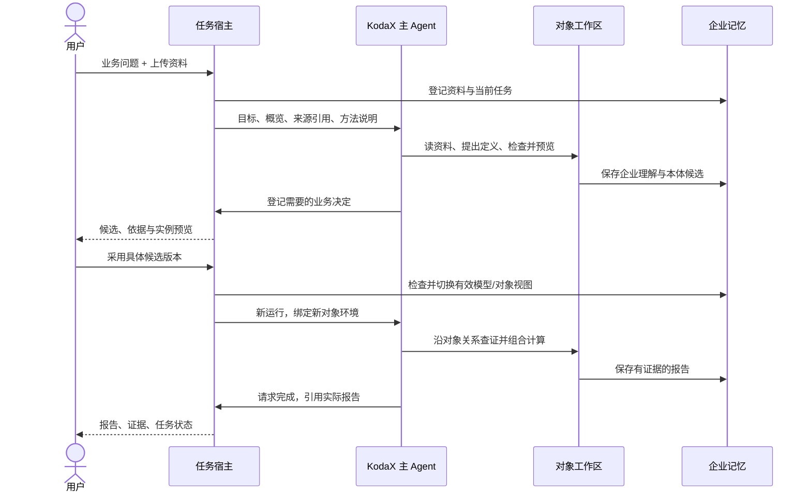

# DataEngine Agent 设计方案

日期：2026-09-07。本文件把[行为规格](AGENT_DESIGN.md)落实为 Agent 的组成、配置、对象环境和应用契约，作为 [FEATURE_003](features/v0.1.0.md#feature-003) 的设计附件。状态为设计交付，尚未实现或运行验证；这是方案版本，不是产品发布。

## 1. 第一版 Agent 的组成

**一个主 Agent，在当前企业的对象工作区中，围绕一项任务持续查证、操作和交付。** 企业理解、接入、建模、报告和维护使用同一套执行能力与记忆。

| 组成 | 第一版负责什么 | 归属 |
|---|---|---|
| Agent 配置 | 稳定的角色、决策原则、五种工作方法和回复约定 | DataEngine 的说明文本 |
| KodaX Runtime | 模型选择、会话、一次运行中的模型与工具循环、运行事件和停止 | 直接消费 SDK |
| 任务宿主 | 绑定企业/任务/运行、装配上下文、接收用户决定、核对完成、把事件映射到界面 | 轻量应用服务 |
| 对象工作区 | 按需发现对象与方法、保持本轮引用、执行语义方法与检查 | 借鉴 NOOA 的 harness 设计 |
| 企业记忆存储 | 保存任务、来源、定义、事实与成果及其版本 | 本地 SQLite 与原件文件 |

这些是一个本地应用内的职责分工，不分别建设服务。任务宿主调用 KodaX 启动和继续运行，不自行再写一套模型循环。模型负责选择有意义的下一步；对象方法负责真实操作，应用服务负责有效状态和写入条件。

## 2. Agent 的身份说明与工作方法

### 固定身份说明草案

以下内容用作主 Agent 的配置文本；真实数据与任务另行装入上下文。

> 你是 DataEngine 企业记忆助手。围绕用户当前的业务目标，建设、使用和维护可复用、可检查的企业记忆。
>
> 开始工作时读取当前任务与企业概览。目标清楚时直接行动；目标宽泛时先形成一份有用的初稿，只补问最影响下一步的问题。优先使用已有资料和已采用定义。
>
> 在对象工作区中发现类型与方法，按需读取资料、对象、关系和证据。统计与已定义规则通过实际方法执行。区分用户陈述、来源事实、模型假设和已采用定义；未知、缺失、冲突与数据范围必须保留。
>
> 根据任务选择理解企业、接入资料、辅助建模、调查报告或维护记忆的方法，可以往返补充。无业务本体时使用企业理解、来源和建模对象启动；有业务本体时优先沿其业务对象工作。
>
> 在用户目标和已有授权范围内自主读取、检查、计算和保存草稿。重要业务语义的采用需要与具体候选关联的用户决定，不能自行声称获得确认。新推断与用户已编辑内容冲突时提出差异，不直接覆盖。
>
> 每次真实保存后引用对应成果。必须等待用户时登记具体问题与原因；交付达到目标时请求结束任务。停止、失败或预算结束时保留已完成成果，不能把运行结束写成任务完成。
>
> 回复简洁，先说做成什么，再给依据、范围和必要的下一步。用户应能打开相关成果；不要把内部推理、未执行计划或工具猜测当作执行记录。

说明文本定义行为，不承担权限或版本检查。来源正文作为资料传入，不拼入身份说明；企业内容中的指令不能扩展执行范围。

### 五张简短方法卡

第一版可一并提供这五张方法卡，无需额外模型进行意图分类或单独部署专家。下面的对象名是 DataEngine 的拟定领域名称。

| 方法 | 使用条件 | 核心步骤 | 本段交付 |
|---|---|---|---|
| 理解企业 | 空白空间、目标宽泛，或企业理解出现新信息 | 阅读已有企业/来源摘要；整理业务、用户职责和当前目标；标明未知；保存增量修改；必要时补问 | 企业理解初稿及当前任务 |
| 接入资料 | 用户提交文件或选中已授权来源 | 登记原件/来源版本；解析；检查结构、范围和样例；说明与任务的关系及缺口 | 可读来源、画像与接入摘要 |
| 辅助建模 | 身份、关系或统一口径影响当前目标，且已有相关资料观察 | 明确任务；观察资料；提出概念；检查语义与备选；设计映射并预览实例；用任务和反例检查 | 有依据的候选、预览和待决定项 |
| 调查报告 | 范围明确，已有适用对象接口或可明确标记的候选预览 | 发现类型；取得对象集合；沿关系查证；调用计算；核对完整性；解释并保存 | 绑定数据/定义版本的报告 |
| 维护记忆 | 新资料、明确纠正或已有结论受到影响 | 对照原版本；区分事实刷新、映射变化、定义变化；执行普通更新或提出候选；说明影响 | 新事实/成果版本或具体修订建议 |

方法切换不清空任务或重建企业。用户临时要求解释一个概念时，回答后继续原目标；明确切换目标才暂停旧任务。

## 3. 运行时怎样获得上下文

每次启动或续接 KodaX 运行前，由任务宿主装配以下内容：

| 内容 | 来自哪里 | 装入多少 |
|---|---|---|
| 身份与方法 | Agent 配置 | 上述稳定说明与简短方法卡 |
| 当前工作 | 任务记录 | 目标、范围、交付条件、已完成成果、阻塞及最新用户输入 |
| 企业概览 | 已保存的企业理解 | 相关摘要，陈述来源/状态，尚未解决的关键问题 |
| 对象导航 | 当前工作区 | 来源目录、已采用类型目录、成果引用、可发现的方法 |
| 当前焦点 | 用户在界面选中的成果 | 稳定引用及必要摘要，支持“这条投诉”等指代 |
| 运行边界 | 宿主配置 | 当前企业、来源/定义版本、可用能力及执行预算 |

不把所有表格和整套本体塞入提示词。详细定义、文档片段、对象集合通过工作区按需读取；集合始终带总数、分页或截断状态。

一次运行内部继续使用 KodaX 的原有循环。每次对象动作的结果返回最新值或引用、变更引用及相关状态，模型据此继续；无需假设 SDK 在每次模型调用前具有尚未验证的专用上下文钩子。压缩对话后仍可通过任务和成果引用重读业务记忆。

首版续接明确使用新的 `runs.start`，重新绑定当前上下文与 `extensionRuntime`。若已有运行，先请求停止并等其结束、核对成果，再启动下一次；设置等待上限，超时保持暂停并显示实际状态，不并发补开运行。公开 `submitInput` 契约没有本轮 `options.extensionRuntime` 参数，不能假定其自动继承规则符合本产品；后续核对后再决定是否使用。[已核对的 SDK 输入契约](https://github.com/icetomoyo/KodaX/blob/41a905c1da1f426404b6a1e8bc5a83eb5e697876/src/sdk-runtime.ts#L1880)

## 4. NOOA 思路怎样落到对象工作区

### 从固定工作对象进入企业业务对象

Agent 面前有一个绑定当前企业和任务的工作区。以下对象分组及方法是本产品设计，不是 KodaX 或 NOOA 已存在的 API。

| 对象入口 | 保持什么状态 | 对模型开放什么能力 |
|---|---|---|
| 当前任务 | 目标、范围、状态、待办、已保存成果及等待问题 | 读取工作记录、保存工作摘要、提出问题、请求完成 |
| 企业理解 | 有来源和状态的企业陈述、用户职责与业务目标 | 查看、提出补充、保存明确编辑、查看冲突 |
| 数据来源 | 已接入来源、版本、解析状态与访问范围 | 登记已提交资料、查看结构、读片段、检索证据 |
| 本体模型 | 已采用定义和候选；概念、关系、口径、约束与映射 | 查看定义对象、提出修订、检查、实例预览、比较影响 |
| 业务对象 | 当前模型与数据快照形成的类型目录和对象引用 | 发现类型、取实例/集合、访问关系、调用已实现语义方法、取证 |
| 成果 | 企业摘要、报告、修改建议和历史版本 | 保存、打开、比较、标记有新资料待更新 |

**本体有两种参与方式：它本身是可检查和修订的对象；它的有效定义又决定业务对象的接口。** Agent 可以检查“投诉关联楼栋”的定义对象，也可以沿这个已采用关系读取某条投诉所属的楼栋。

方法说明包含：含义、参数类型、结果类型、适用范围、是否写入和可能返回的未知/失败。业务方法还关联定义版本、来源规则和实际实现。没有受支持实现的方法只进入建模候选，不因模型起了一个方法名就成为可执行能力。

### 对象组合与证据

以“找出已办结投诉的恢复证据缺口”为例，一次实际对象调查应能完成：

1. 发现投诉类型，阅读处理状态及恢复证据的定义。
2. 取得指定时间/范围的已办结投诉集合，保留集合引用和完整性信息。
3. 沿投诉到楼栋、投诉到回访等关系取得关联对象；未解析的关联单列。
4. 对相关对象调用已实现的恢复证据方法，分别保留处理状态、回访、测温、维修及缺失项。
5. 组合筛选/统计与证据读取，形成报告引用的结果集。

中间对象/集合在本轮对象执行环境中复用，模型不必把每个对象全文抄回下一次调用。跨进程、跨运行或重开时使用稳定引用重新解析。引用属于特定快照，不会因最新数据改变而悄悄换成新对象。

这一定义保留 NOOA 式有状态对象、方法、按需发现及组合执行。具体用 CodeAct 还是受限组合接口承载，留作一项接入验证；接口设计不要求先建立通用查询语言或通用代码平台。KodaX 始终负责唯一的模型循环。

### 本体修改怎样改变环境

先生成具体候选，在指定来源与映射版本上检查并预览；用户决定对应的是这一候选版本。应用服务核对采用决定、基础版本与检查结果，待对象视图准备成功后切换当前模型引用；失败时继续保留原有效模型。

当前运行固定原模型/快照。当前任务正在等待这项采用决定时，采用成功即更新任务的快照引用、修订号和对应等待项，再按原目标续跑或完成，无需用户再次说“继续”。若只是独立维护模型，不自动迁移其他任务；用户要求历史任务使用新定义时再登记修订。新运行构造对应工作区并刷新类型/方法说明，历史成果仍固定原版本。

旧运行的中间句柄不能混入新工作区；显式按稳定引用读取历史证据仍可用。身份规则改变后，无法可靠对应的新旧对象明确返回无法对应，不凭相同名称强行迁移。事实刷新沿用原定义、产生新快照；本体变化才改变语义接口。

## 5. 最小状态与保存契约

### 四种标识分别承担什么

| 标识 | 用途与寿命 |
|---|---|
| 企业 ID | 记忆归属；第一版仅一个企业 |
| 任务 ID | 业务目标与交付；可跨多次运行和会话继续 |
| KodaX 会话 / 运行 ID | 对话载体 / 一次执行；只作为执行关联，不当作业务记忆主键 |
| 成果/对象引用 | 种类、稳定 ID、版本及必要快照；对话和前端打开同一份内容 |

一张任务记录包含：目标、范围/时点、交付条件、修订号、状态、成果引用、来源/定义版本、未决项和下一步。执行记录由工具结果更新；模型可补充工作摘要和问题，不可自行伪造已完成的工具操作。

任务状态为进行中、待补充、已暂停、已完成。首轮一个活动任务、一次活动运行。用户纠正影响执行条件时，宿主递增任务修订号并停止旧方向；Agent 写入在提交事务内同时核对运行有效性和任务/成果基础版本，迟到的旧动作不能覆盖新决定。已提交成功的内容保留并如实展示。

### 所有对象动作共用的结果要求

- 读取：值或可继续读取的引用、来源证据、数据/定义版本、范围及完整性；没有数据、关系未解析与数值为零分别表达。
- 写入：新成果引用、原版本及检查结果；需要采用决定时返回待决定候选，不显示已生效。
- 失败：失败原因、是否可以修正/重试、已完成的部分；参数错误、来源不可用、版本过期与执行失败可区分。

写入使用操作标识去重，同一操作重复提交返回原结果；新一次用户编辑使用新操作标识并核对基础版本。SQLite 事务保存结构化成果及必要任务关联；原文件先登记状态，解析失败可保留原件。技术写入检查不等同于业务语义已经正确。

报告固定问题、时点、来源/本体/映射版本和证据引用，区分事实、解释及未决项。用户补资料后可以生成新报告，旧报告继续显示原依据。企业理解按陈述保存作者、依据和状态，避免整份模型草稿覆盖用户编辑。

## 6. 主 Agent 与应用的最小接口

这些是应用契约名称，实际路由和 SDK 注册名在实现时确定。

| 接口 | 输入 | 应用保证的输出/效果 |
|---|---|---|
| 提交消息 | 消息标识、任务/修订、文本及焦点引用 | 保存用户输入；空闲时启动运行，状态追问读取当前状态；影响模型的消息按第 3 节串行续接，纠正先使旧方向失效；返回任务/运行关联 |
| 提交资料 | 文件或已有授权来源引用、当前任务 | 原件/来源引用与解析状态；在任务范围内触发接入工作 |
| 提交决定 | 问题标识、候选版本、用户选择/文字、基础版本 | 普通回答更新对应未决项；明确采用决定触发检查和对象视图准备，成功后更新模型及等待该决定的任务，按原目标继续；失败保留原模型与阻塞，返回原因/差异 |
| 停止运行 | 当前任务与运行 ID | 请求停止后续动作，保留实际完成成果和暂停原因 |
| 读取任务与成果 | 稳定引用，必要时指定版本和视图 | 当前工作记录，或同一成果的原文/表格/定义/关系/证据视图 |
| 订阅任务事件 | 任务 ID 与该任务的已读序号 | 带当前位置的状态快照及后续应用事件；游标失效则重新取快照，重连无需重新执行业务动作 |

模型配置通过应用设置提供连接状态、provider/model 和测试连接入口；凭据仅由宿主持有。连接器授权由应用处理，Agent 看到可用状态和范围。首条资料路径采用 Markdown/文本和 CSV。

### 三个任务控制动作

除领域对象方法外，Agent 需要三个小型任务动作，避免前端从聊天措辞猜状态：

| 动作 | 模型提供什么 | 宿主检查什么 |
|---|---|---|
| 保存工作摘要 | 当前进展说明、未决项、建议下一步 | 关联的任务修订有效，完成事项能对应实际成果 |
| 请求用户补充 | 问题、原因、关联来源/候选、需要的回答类型 | 保存待补充事项；需要决定的操作继续保持未采用 |
| 请求完成任务 | 交付引用、与目标的对应说明、仍保留的限制 | 成果真实存在，所需保存/检查完成，无阻塞交付的等待项；不因自然语言“完成”直接改状态 |

宿主接受请求补充/完成后，先保存对应任务状态，并关闭本 Run 的业务操作入口，只允许模型给出简短收尾。收尾结束则自然结束运行；继续调用业务工具时拒绝并停止该 Run，收尾超时也请求停止。SDK 的终止原因与任务的已完成/待补充状态分别记录，界面显示已保存的业务结果。请求被拒绝时返回尚缺的条件，本 Run 继续工作；无需增加公开的“收尾中”任务状态。

回答待补充问题后，重新读取最新任务和候选，再开始新运行。对话中的明确决定可以登记到同一接口，不强迫用户重复点击确认；歧义回答不能代替决定。“决定已收到”与“采用成功”分别记录，采用失败不能清除对应阻塞或显示已生效。

宿主只能机械检查成果、版本与必需步骤，不能机械证明业务回答完全满足目标。Agent 负责解释交付与目标的对应关系，用户可以纠正或继续原任务；“证据不足”的完成边界按[行为规格](AGENT_DESIGN.md)第 9 节处理。

## 7. 前端从哪些真实事件得到反馈

模型自然语言用于交流，任务状态与成果视图由执行和保存事件驱动。以下事件是 DataEngine 的应用事件，不能视为 SDK 原生事件名。

| 事件含义 | 谁产生 | 界面如何呈现 |
|---|---|---|
| 开始 / 结束 / 中断一次运行 | 宿主结合 SDK 实际状态 | 正在工作、已停止或执行失败；不自动将任务标为完成 |
| 开始 / 完成一个对象操作 | 对象适配器结合执行结果 | “正在读取投诉表”等简短进度，可展开结果与失败原因 |
| 成果已保存 | 成功写入的应用服务 | 右侧打开具体成果及版本 |
| 等待用户补充或决定 | 已持久化的任务问题 | 对话中的问题卡与相关依据，可在此回答 |
| 任务状态改变 | 任务服务 | 展示已完成、待补充或暂停，以及真实交付入口 |

应用事件使用任务范围内的单调序号，并携带关联运行、操作或成果引用；SDK 的会话游标只作来源信息，不替代任务游标。重连时以一致性读取返回任务/成果状态及该任务当前位置，再补其后的应用事件；游标失效则重新取快照。只需保留成果提交、等待项和任务变化这些关键记录，缺失的临时进度不编造为完整历史。

重放事件只恢复展示，不重新执行写入。原始 SDK 日志留作开发核查，无需建设独立事件平台。

## 8. 一次完整工作时序

这是一条涉及新本体采用的路径，普通编辑和既有模型调查可连续执行。热力反例要求保持：已办结不等于恢复，缺失回访不等于无问题，单户反馈不外推整栋楼。具体结论只能来自当时可见来源和已采用规则，不能预载评测答案。

## 9. 实现前已确定什么、还需验证什么

**本设计确定：**一个主 Agent；上述身份与方法；任务/运行分离；本体定义对象与业务对象两类访问；按需上下文；具体候选采用；真实事件驱动成果展示；本地轻量保存。沿已约定的“用户任务 → 工具执行 → 成果/证据 → 保存与重开”边界验证。

**SDK 接入依据：**沿用已核对源码的 embedded/inline、单 Agent 运行和 run-scoped extension 接法，具体接口与固定源码引用见[技术参考](AGENT_DESIGN.md)第 11 节。这是实现设计，不是 SDK 已接入的声明。

**保留一项关键工程验证：对象组合执行器。** 用同一条热力链验证类型发现、两种关系、语义方法、中间对象复用、证据读取及新运行恢复引用；比较可复用的 NOOA 组件/CodeAct 与受限组合方式，选择满足这条契约的最小接法。若只返回预制报告或散装 JSON、无法依据本体发现并组合对象方法，则不能认定对象 harness 已完成。

实现后的最小演示需同时包含：从上传开始、真实对象调查、关键决定、保存/重开、一次纠正影响后续任务；另核对停止后的迟到写入、候选过期和重复请求。设计评审不能替代这些运行验证。本轮仅交付设计，没有新实现票、SDK 接入、前端改造或模型实验。
