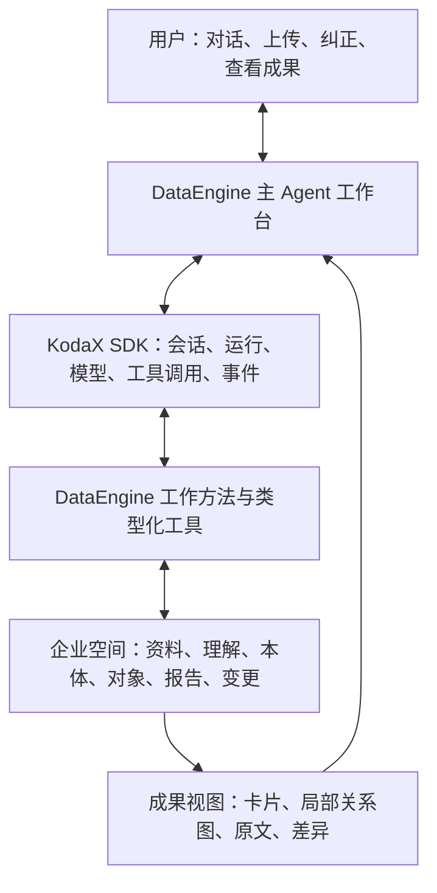

# DataEngine 主 Agent 设计草案

日期：2026-09-07。依据：用户确认的 [产品目标](PRODUCT.md)、[MVP 范围](MVP.md)，以及本次对 KodaX SDK、NOOA 官方资料的核对。本文件是待实现设计；现有浮窗没有这些执行能力。功能规格归入 [FEATURE_003](features/v0.1.0.md#feature-003)，前端由 FEATURE_005 承接。

## 1. 设计结论

以 KodaX SDK 作为唯一 Agent 运行底座，构建一个围绕企业记忆工作的主 Agent。借鉴 NOOA 的对象化状态、类型化方法、按需展开和程序组合，把企业空间变成 Agent 能持续读写的工作环境。

产品中的连续体验是：对话明确一个目标，Agent 查看当前资料与记忆，调用工具完成可执行的工作，留下可检查的成果，再针对实际缺口提问。企业理解、数据接入、本体设计、报告和维护是同一 Agent 的不同工作方法，可以往返补充。

首轮采用类型化工具调用。对象引用、方法说明和返回结构由 DataEngine 定义；暂不引入 NOOA 运行时或模型生成代码的 REPL。后续确有大量组合查询需求时再评估 CodeAct，首轮不宣称复现了 NOOA 的全部能力。

## 2. 四部分如何配合

| 部分 | 本轮职责 |
|---|---|
| KodaX SDK | 接管模型调用与运行循环、会话继续、执行事件和工具调用；DataEngine 直接消费实际 SDK 契约 |
| 主 Agent 工作方法 | 根据目标和可用资料选择下一步，提出概念与映射、调查证据、解释结果和缺口 |
| 企业空间与工具 | 保存资料、身份、定义和版本；执行解析、查询、计算、验证、受控保存；返回明确成功或失败 |
| 前端 | 展示对话与真实执行进度，打开当前成果，让人编辑理解、检查证据、决定关键语义 |

前端与 Agent 读取同一批成果。页面上的企业理解、本体定义和报告都来自持久化对象，不从聊天文本临时拼出另一套状态。

## 3. 先有工作对象，再形成业务本体

从空白企业开始就需要少量由产品定义的工作对象：

| 工作对象 | 保存什么 |
|---|---|
| 企业理解 | 企业做什么、用户职责、当前业务目标、工作流程、已知内容与待补充问题 |
| 数据来源 | 原文件或连接器引用、来源版本、读取时间、解析结果、字段与样例、可用状态 |
| 建模草稿 | 概念、关系、口径、映射建议，以及依据、备选和待决定事项 |
| 报告 | 问题、适用时点、使用的记忆版本、事实、解释、证据与未决项 |
| 修改建议 | 要改什么、原版本、理由、依据、影响、检查结果与应用记录 |

这些对象使 Agent 在尚无业务本体时也能工作。企业本体随后描述换热站、楼栋、投诉单、回访、维修等业务概念；实际概念须经资料观察和任务分析决定。一个概念可以由多个来源共同支撑，一张表也可能包含多种业务含义。

**工作对象的类型定义与企业业务本体分别维护。** 首轮业务本体采用可版本化的结构定义与映射，交给通用查询/导入工具解释执行，不让模型为每个新概念生成、部署一段程序。

每个可引用成果至少有稳定 ID、种类、版本和状态。业务对象另带本体/映射版本、有效时间及证据定位。跨会话传递可重新解析的引用，不能依赖某次进程的内存地址。

## 4. 主 Agent 怎样工作

### 一轮行动

1. 读取企业空间概览、当前任务、选中成果及相关版本。
2. 根据现有事实判断可以完成什么；能从资料查到的先查，缺少业务含义或访问授权才询问用户。
3. 调用类型化工具读取或处理资料；统计和关联交给程序，模型负责解释与提出设计。
4. 将结果保存为具体成果或候选修改，工具返回成果引用和版本。
5. 在对话中说明做了什么、依据在哪里、还缺什么；前端打开对应成果。

同一轮可以有多次工具调用。设置有限轮次与输出预算，失败时保留已经成功保存的成果，说明卡在哪一步；不靠无限重试把状态变成成功。

### 五种工作方法

| 方法 | Agent 的主要判断 | 工具留下的成果 | 什么时候询问用户 |
|---|---|---|---|
| 理解企业 | 找到企业业务、使用者和一个值得处理的问题 | 企业理解初稿 | 目标、职责或关键说法缺失；每轮优先问 1—2 个相关问题 |
| 接入资料 | 识别资料用途、内容范围、相关性及缺口 | 来源、解析预览、接入摘要 | 需要选文件/授权；资料含义影响使用但无法从现有内容判断 |
| 辅助建模 | 决定概念粒度、身份、关系成立条件和统计口径 | 概念卡、关系、映射候选、实例预览 | 存在关键歧义或冲突，或新定义将改变业务结论 |
| 调查与报告 | 按问题读取对象/证据、调用计算、识别结论边界 | 有来源的简易报告 | 问题范围不明确，或缺口使核心判断无法成立 |
| 维护记忆 | 判断新增资料影响事实、映射还是业务定义 | 影响说明、修改建议、保存记录 | 需要解决矛盾或确认重要语义变更 |

工作方法先作为简短说明和工具约定实现；不为每种方法建立一个子 Agent，也不增加流程调度平台。建模方法采用现有[六步建模设计](experiment/ONTOLOGY_MODELING.md)，阶段成果可查看，用户无需填完六页表单。

运行状态采用就绪、执行中、待补充、失败/中断、完成；企业理解、本体等成果各自有状态。企业理解还是初稿时仍可接入资料，存在一项未决定义时仍可查看不受影响的对象。

“主动”首先指在当前任务中识别下一步、指出新资料带来的问题和提供建议。首轮由进入空白空间、用户消息、上传完成或明确的继续操作触发，暂不运行全天候后台巡检。

## 5. 企业记忆如何保存与进入上下文

### 三类内容，三种处理

| 内容 | 处理方式 |
|---|---|
| 会话与临时工作状态 | KodaX 管理对话和执行，DataEngine 保存当前目标、成果引用与待处理事项；压缩会话不会删掉企业成果 |
| 原始资料与已登记的企业知识 | 产品持久化保存；区分用户陈述、来源记录、模型建议和已确认定义，保留时间与依据 |
| 模型解释与假设 | 可存为报告或候选，不能仅因写进聊天就成为企业事实；被引用时保留其假设/待查状态 |

企业理解可以自动保存为草稿，界面明确展示。用户直接修改时留下作者和版本；一句用户陈述可以登记为“用户提供”，不伪装成原始系统已验证事实。作者、依据和状态关联到具体陈述；新资料或模型推断与用户已编辑内容冲突时，保留原内容并追加待决定项，不能用整份新草稿覆盖。明确且有效的原规则可复用，不为每个字段增设确认。

模型每轮先得到少量导航：企业理解摘要、当前目标、资料目录、可用概念、选中成果引用、相关未决项及工具说明。随后按需读取具体字段、文档片段、关系和证据。列表必须返回总数、分页或截断标识，不能把读到的样例当成全部数据。

每次调查或建模任务绑定一组来源/定义版本；新资料进入后建立新版本。完成中的报告继续对应原版本；之后可标记“有新资料待更新”并生成新报告，保留旧报告的依据。引用的来源若当前不可用，显示失效状态和历史版本，不能用另一个来源或最新内容悄悄替代旧证据。

首轮一个企业空间、单用户、串行修改，本地 SQLite 保存结构化记录、文件保存原件即可。KodaX 的会话存储和业务记忆各自负责自己的记录，通过会话/运行 ID 与成果引用关联；不把 SDK 会话压缩摘要当成业务知识库。

## 6. 最小工具与保存边界

下面是 DataEngine 的拟定领域契约，不是 KodaX 或 NOOA 的现成 API。工具名称在实现时可按 SDK 注册要求调整。

| 能力 | 输入 → 输出 | 本轮行为 |
|---|---|---|
| 查看空间 | 企业引用 → 理解摘要、资料/成果目录、未决项 | 提供导航，避免全量注入 |
| 了解类型 | 类型引用 → 定义、字段、关系和可用方法 | 按需披露能力，避免加载完整企业模型 |
| 读取/查询 | 引用、版本、字段/查询条件 → 内容片段、关系、证据、分页信息 | 原始来源与业务对象均可使用 |
| 保存企业理解 | 基础版本、结构化修改、依据 → 新草稿引用 | 已有明确用户编辑可直接登记；模型补充标为建议 |
| 接收资料 | 已上传文件引用或已授权连接器配置 → 来源引用与解析状态 | 原件先保存，解析失败也可查看错误和重试 |
| 检查资料 | 来源引用 → 字段、样例、缺失与可用范围 | 程序画像和 Agent 接入解释分别保存 |
| 提出建模草稿 | 业务目标、概念/关系/口径/映射候选、依据 → 草稿引用 | 结构合格不等于语义正确 |
| 检查并预览 | 指定草稿版本、来源版本 → 检查结果、实例预览、未解析项 | 查引文、身份、类型、时间、映射；不强行补关系 |
| 计算 | 已实现函数与定义版本、范围 → 结果、输入/证据与版本 | 首轮少量固定查询/聚合，分母为零和缺失显式返回 |
| 保存报告/修改建议 | 基础版本、内容、证据/影响 → 成果引用 | 报告不会自动改变企业事实 |

正式采用业务定义或重要修订使用应用服务的保存动作：关联具体候选版本、语义决定和检查结果。Agent 可提出并检查修改；不能仅传入一个自己生成的 `approved=true` 代替用户决定。用户已经明确要求的普通编辑、既定映射下的数据刷新可按该范围执行，不重复索要确认。

检查通过的候选仍为预览；用户采用具体定义版本后才成为当前业务模型。普通对象查询和报告默认使用已采用的版本；若用户查看候选效果，结果必须标为预览，并关联该候选与来源版本。

检查与采用期间若基础版本变化，返回过期提示，重新检查后再应用。工具写入使用请求标识避免重试产生重复成果；一次失败不能留下显示为成功的半份正式定义。

数据接入依赖真实解析器和连接器。Agent 可以协助选择、配置、解释和调用已提供接口；腾讯文档等系统仍需各自的连接器与授权。首条路径先接 Markdown/文本和 CSV，后续按明确需求加入 PDF 或一个外部连接器。

凭据通过设置或服务端环境提供，不进入企业资料和模型对话。资料正文中的命令视为来源内容。运行时只提供当前企业的数据能力；任意文件、命令、网络、评测答案和未来事件不属于这个 Agent 的工具范围。

## 7. 用户如何直观看见企业大脑形成

主对话中，Agent 说“已保存企业理解”时，右侧必须出现真实保存的企业理解及版本。说“发现口径冲突”时，打开两种说法、来源和各自影响。工具执行中展示实际操作和结果摘要，不展示未经核实的完成百分比，也不依赖模型内部推理文本。

| 当前工作 | 右侧主要视图 |
|---|---|
| 定义企业 | 一页可编辑企业理解，显示已知内容和待补充项 |
| 接入数据 | 原文/表格预览、来源版本、接入摘要与解析问题 |
| 设计本体 | 概念卡：定义、身份、边界、用途、依据；少量关系的局部图 |
| 检查映射 | 某条源记录如何形成对象/关系，未匹配记录为何保留 |
| 使用对象 | 一个对象的属性、相关对象、时间和原始证据 |
| 阅读报告/维护 | 报告的证据入口，或修改前后内容、依据和影响 |

概念关系图和实例关系图分开：前者展示“投诉关联楼栋”这类定义，后者展示某条投诉具体关联哪栋楼。用户从一个对象展开邻居，首轮不渲染全企业的密集网络图。

左侧保留企业空间、任务和成果入口；企业理解、来源、本体、对象、报告可独立打开。它们是同一对话工作的不同查看入口，首次使用不要求用户先学习一套后台导航。

## 8. 热力案例的一次完整体验

以下是拟演示流程，不是已经执行的 Agent 对话或建模结果。

1. 用户进入空白空间。模型可用后，Agent 了解企业做什么、用户负责什么、首先想解决哪个问题。用户也可以直接上传公司说明，由 Agent 先读再补问。
2. 用户选择“投诉处理与异常复盘”。Agent 保存企业理解初稿，建议首先接入企业说明、投诉处理口径和投诉记录。
3. 资料接入后，Agent 展示读到的业务分工及规则，指出判断处理效果还需要维修和回访记录；随后接入相关来源。
4. Agent 围绕当前任务提出少量概念和关系，对身份、状态、时间与证据边界给出理由。“客服办结不等于居民供暖恢复”已有现行规则支撑；未审批讨论中的不同说法作为冲突线索保留。
5. 用户查看概念卡和关键选择，检查通过后先看少量实例预览；采用该定义版本后形成当前业务对象。源记录、对象和相关记录之间可以逐个回查。
6. 用户问“这批已办结投诉，哪些还有恢复证据缺口？”程序按已明确的范围和定义查询，Agent 给出带证据的短报告；缺失回访不能被写成已经改善。
7. 用户补充一条此前缺少的回访。Agent 说明影响哪个投诉及报告，按既定映射更新事实，保留来源与旧结果。这个例子验证事实维护，不冒充本体演变。

本体演变另用确实改变概念、关系成立条件或统计定义的资料验证；不为首轮演示人为制造一次架构升级。

## 9. 首轮建设顺序与验收

先实现一个最小完整段落：**进入 Agent → 主动了解企业 → 企业理解保存并显示 → 上传一份资料 → Agent 读取并修订理解 → 重新打开仍存在。** 这一段同时交付主对话、右侧成果与真实工具运行，先让用户实际感受到产品。

随后接入建模草稿与实例检查，再做一份有证据的报告，最后完成一次记忆更新。每段都能在前端操作与检查，不先把全部后端做完。

验收沿已约定的“用户任务 → 工具执行 → 成果读取/证据 → 保存并重新打开”公共边界：

- 真实 KodaX 运行能够读来源、保存草稿，事件和工具结果对应实际成果。
- 同一企业第二次会话能按引用找到已存理解和资料，不要求用户重复介绍。
- CSV 样例与全量计算区分，缺失/冲突保留，办结不被计算为恢复。
- 失败、取消和重复请求不伪造成功或重复正式写入；过期候选无法覆盖新版本。
- 未确认模型建议不变成已确认定义；原始证据、私有评测和运行配置边界可检查。
- 用热力的一条实际记录链检查语义；结构检查和一次成功体验不作为普遍准确率结论。

这次仅形成设计，不运行新模型实验、不改旧基线、不勾选产品票完成。完整 NOOA/CodeAct、图数据库、多 Agent 编排、全天候维护、通用连接器平台及大规模评测留到后续。

## 10. NOOA 参考依据与取舍

本次核对 NOOA 官方 `main` 提交 `e137e1b5eee3f36ad0bba08cea0931aa292563a4`。下表左列是官方机制，右列是本项目的设计推导。

| 官方机制与依据 | DataEngine 的借鉴与限制 |
|---|---|
| 字段表达状态、方法表达能力、类型与说明约定输入输出；见[官方概览](https://github.com/NVIDIA-NeMo/labs-OO-Agents/blob/e137e1b5eee3f36ad0bba08cea0931aa292563a4/docs/tour.md) | 工作成果与领域操作有类型；不把 Python 类本身当作企业本体，也不给每个对象分配一个 Agent |
| 类型检查不能证明外部世界和业务约束成立；见[确定性编排](https://github.com/NVIDIA-NeMo/labs-OO-Agents/blob/e137e1b5eee3f36ad0bba08cea0931aa292563a4/docs/concepts/orchestration.md#types-validate-values-python-validates-the-world) | 保存方法内部强制引用、版本与状态检查；关键语义另留业务依据和决定，不让模型自行宣布全部检查通过 |
| `doc(obj)` 按需披露对象方法；见[工具与可见性](https://github.com/NVIDIA-NeMo/labs-OO-Agents/blob/e137e1b5eee3f36ad0bba08cea0931aa292563a4/docs/concepts/tools-and-visibility.md) | Agent 先看目录和摘要，再读取类型说明、字段、关系和证据；前端可打开同一对象 |
| CodeAct 在方法调用的执行环境中传递实际 Python 对象并保留中间值；见[实现](https://github.com/NVIDIA-NeMo/labs-OO-Agents/blob/e137e1b5eee3f36ad0bba08cea0931aa292563a4/src/nooa/strategies/codeact.py) | 首轮跨工具传可持久解析的引用，提供固定查询与聚合；这不等同 live-object 传递，尚无任意代码组合、循环与中间值自由计算能力 |
| 默认上下文与持久化需要区分；可选记忆包提供 SQLite、记忆 UUID、关系和更新能力；见[上下文寿命](https://github.com/NVIDIA-NeMo/labs-OO-Agents/blob/e137e1b5eee3f36ad0bba08cea0931aa292563a4/docs/concepts/prompts-and-context.md#lifetime-persistence-and-memory)和[记忆包](https://github.com/NVIDIA-NeMo/labs-OO-Agents/blob/e137e1b5eee3f36ad0bba08cea0931aa292563a4/packages/nooa-memory/src/nooa_memory/README.md) | 本项目自行维护正式企业资产及证据/定义版本。NOOA 有通用记忆能力，但企业身份对齐、指标口径和本体采用流程仍要由产品提供 |

若后续任务频繁需要新增小工具，或已有方法组合导致过多模型往返，再评估受隔离的 CodeAct 执行能力。仍复用 KodaX 的运行循环，并通过同一领域方法访问数据；不先运行两个 Agent Runtime。采用 NOOA 的设计思路不能直接证明本产品的准确率或成本收益。

## 11. KodaX SDK 的具体接法

本次核对官方默认分支 `KodaX` 的提交 `41a905c1da1f426404b6a1e8bc5a83eb5e697876`，源码包版本 `0.7.96-beta.1`。这是源码核对结果，没有安装、编译或启动 SDK；npm 已发布包不一定与该提交相同，实施时固定实际使用版本。旧 `main` 分支不作为本次 SDK 依据。

**推荐：轻量 Node/TypeScript 服务端，直接嵌入 SDK 的 inline 形态，先用 `sa` 单 Agent 循环。** 宿主提供主对话 API 和事件流；已有 Python 来源、导入与证据能力通过固定操作/结构参数复用，参数不能变成任意 shell 或文件路径。旧浏览型实验室保留作为历史原型，不需要先重写所有 Python 数据能力。

| 接入点 | 已核实接口与本项目使用方式 |
|---|---|
| 会话和运行 | `@kodax-ai/kodax/runtime` 的 `createKodaXRuntime`；选择 `mode: 'embedded', isolation: 'inline'`。用 `sessions.create/load`、`runs.start`、`events.subscribe` 与运行结果完成对话及实际进度展示。[Runtime 源码](https://github.com/icetomoyo/KodaX/blob/41a905c1da1f426404b6a1e8bc5a83eb5e697876/src/sdk-runtime.ts#L734) |
| Agent 身份 | 在运行选项中提供 `context.agentProfile`，指定 DataEngine 身份与工作说明；`sa` 路径将其 instructions 映射为完整系统说明。只配置企业主 Agent 所需方法。[入口实现](https://github.com/icetomoyo/KodaX/blob/41a905c1da1f426404b6a1e8bc5a83eb5e697876/packages/coding/src/agent.ts#L47) |
| DataEngine 工具 | `runs.start` 的 `options.extensionRuntime` 传入宿主 adapter；通过 `listRunTools('mcp')` 提供本轮工具定义，`executeCapability('mcp', capabilityId, input)` 调用固定业务方法。输入有 schema，读取标为 `readonly`，保存草稿标为 `mutates-state`。[扩展契约](https://github.com/icetomoyo/KodaX/blob/41a905c1da1f426404b6a1e8bc5a83eb5e697876/packages/coding/src/extensions/runtime-contract.ts#L60) |
| 无须外部 MCP | 上一行的 `'mcp'` 是 SDK 已有的分发通道；这里直接调用进程内 adapter，不要求启动外部 MCP 服务或 transport。采用按运行注册，避免全局工具注册影响其他会话。[分发实现](https://github.com/icetomoyo/KodaX/blob/41a905c1da1f426404b6a1e8bc5a83eb5e697876/packages/coding/src/agent-runtime/run-scoped-tools.ts#L115) |
| 有效工具范围 | 使用 `toolVisibilityPolicy` 与排除列表，只保留本轮业务工具。源码把该范围用于模型可见表与执行检查，直接调用和 `tool_call` 间接调用都需检查；业务方法仍验证企业、引用、版本与来源范围。[范围构造](https://github.com/icetomoyo/KodaX/blob/41a905c1da1f426404b6a1e8bc5a83eb5e697876/packages/coding/src/agent-runtime/run-substrate.ts#L1033)、[执行检查](https://github.com/icetomoyo/KodaX/blob/41a905c1da1f426404b6a1e8bc5a83eb5e697876/packages/coding/src/agent-runtime/tool-dispatch.ts#L211) |
| 配置和存储 | 用专属 `homeDir/profile/sessionsDir` 与干净执行目录，避免企业 Agent 自动载入产品代码仓库的资料或开发指令。SDK 会话存储沿用默认能力，业务成果由 DataEngine 保存。[宿主指南](https://github.com/icetomoyo/KodaX/blob/41a905c1da1f426404b6a1e8bc5a83eb5e697876/public_docs/sdk/embedder-guide.md#L2690) |
| 模型设置 | 复用 provider/model 配置；`/llm` 的 `verifyProviderCredential` 可支持“测试连接”。优先识别服务端环境凭据；首轮在界面输入的密钥只保留在宿主进程内，重启后重新填写，不进入模型消息、企业资料或 Git。[凭据检查](https://github.com/icetomoyo/KodaX/blob/41a905c1da1f426404b6a1e8bc5a83eb5e697876/public_docs/sdk/embedder-guide.md#L2185) |

**实现时特别检查：**

- inline 不能使用 `runtime.hostTools.register`，该接口属于 shared daemon client；选定的进程内 `extensionRuntime` 路径已存在，无须为首轮增加 daemon。
- 不把 `beforeToolExecute` 回调作为唯一门禁：部分权限模式会提前返回。首轮测试直接伪造 `bash` 及借 `tool_call` 转发都不能越过有效工具范围，并检查没有读取评测与未来资料。
- 工具 schema、SDK verifier 与本体语义验证各有边界；关键业务检查必须在 DataEngine 的保存方法内部执行。
- 首次打开若凭据不可用，展示设置入口和真实错误；模型已可用则直接开始企业理解。API Key 不作为 Agent 的提问内容。
