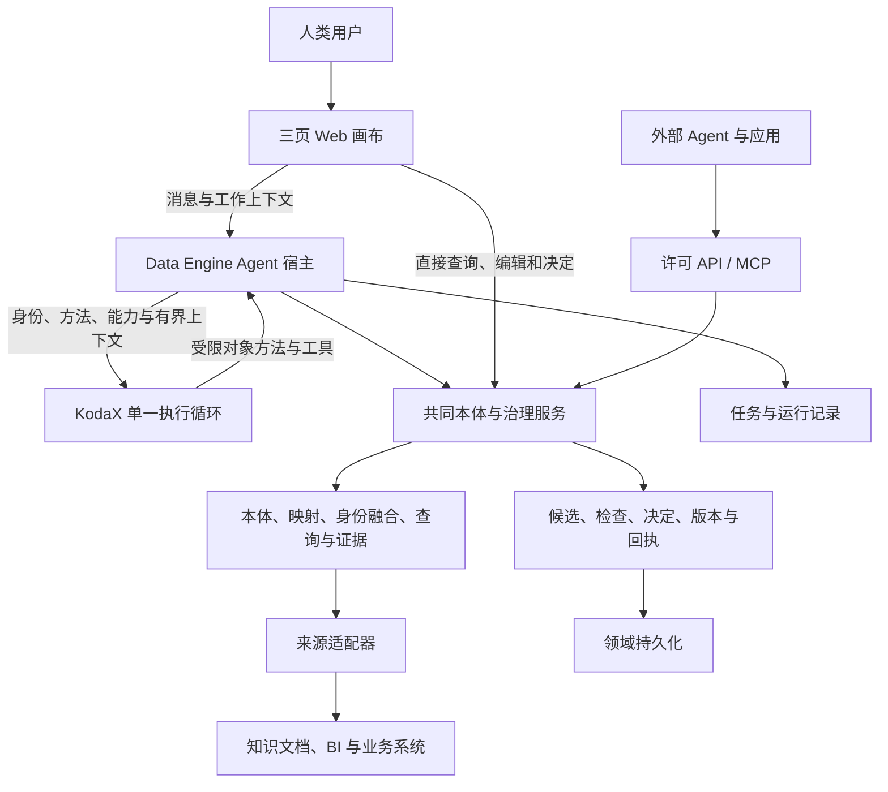

# Data Engine 总体架构（HLD）

更新：2026-09-11。本文只负责模块、数据流与责任分工。产品价值见[PRD](PRODUCT.md)，内部 Agent 行为见[Agent 设计](AGENT_DESIGN.md)，领域协议见[语义契约](SEMANTIC_CONTRACTS.md)。

当前实现小节基于源码 `0b264fa6eb34668b9741af2208098d07334f61c0` 与已有验证记录，本轮只整理文档，未重跑产品验收。目标能力在 FEATURE_012—016 实现；逻辑分层不要求拆分部署服务。

## 1. 系统总览

图表示目标逻辑。当前已有其中部分服务，三页和完整融合仍待开发。外部普通消费不经过 KodaX，前端直接编辑与 Agent 通过共同领域服务执行。

## 2. 责任归属

| 层 | 负责 | 向外提供 | 不承担 |
|---|---|---|---|
| KodaX 执行底座 | 模型调用与工具循环、SDK 运行事件和取消机制 | 实际公开 SDK 合同 | 企业事实、业务授权、映射正确性 |
| Data Engine Agent 宿主 | 绑定企业/执行身份、组装上下文、注册能力、记录结果、检查运行有效性 | 本产品 Agent 会话与运行入口 | 第二套模型循环、凭提示词代替业务校验 |
| Skill 方法 | 指导调查、建模和治理的步骤及交付 | 按需方法文本与包内参考 | 工具实现、授权、连接器安装或自动采用 |
| 本体与治理服务 | 定义、身份、映射、查询、断言、证据、候选与版本 | 同源领域对象、操作和回执 | 布局状态、模型内部推理 |
| 来源适配器 | 按真实契约调用获准来源、处理分页与结果语义 | 实际记录、片段、指标与读取范围 | 自动获得全库权限、自动完成语义对齐 |
| Web 画布 | 人类可视化、选择、直接编辑、差异与操作反馈 | 消息绑定上下文和服务请求 | 第二份对象身份或权限判断 |
| 消费适配 | 按调用方投影可消费契约与内容 | 独立 HTTP/MCP、说明与可选生成客户端 | 启动模型才能查询、向外转交源凭据 |

“本体引擎”是上述领域服务的产品名称，当前可继续在 TypeScript 单体内实现；这项分工不预设图数据库、完整 OWL 或新的 Runtime。

## 3. 当前部署与代码接点

当前为 Node HTTP 服务与静态 Web，KodaX 以 embedded/inline 集成。画布每轮使用临时 SDK session，企业成果和近期工作状态由产品保存；不将旧任务路径的 SDK session 复用机制描述为当前画布恢复方案。

| 接点 | 当前位置 | 含义 |
|---|---|---|
| 模型循环适配 | [runtime.ts](../src/agent/runtime.ts) | SDK 运行、工具注册与事件转换 |
| 产品运行编排 | [app.ts](../src/agent/app.ts) | 页面/任务、上下文、工具范围、完成与停止 |
| 产品持久化 | [memory.ts](../src/agent/memory.ts) | 领域成果、版本、任务、事件与写入资格 |
| Skill/MCP/业务 SDK | [capabilities](../src/capabilities/) | 产品选择性接入的通用能力 |
| 文件对象工作区 | [workspace.ts](../src/agent/workspace.ts)、[domain-objects.ts](../src/agent/domain-objects.ts) | 已有有界方法与句柄，不能直接等同在线融合 |
| 在线来源与对象 | [live](../src/live/) | 只读源连接、映射和按需查询 |
| 人类与外部入口 | [Web](../web/agent/)、[MCP 桥接](../scripts/dataengine-mcp.ts) | 当前四页 UI、独立消费协议 |

详细 SDK 版本、调用证据与限制只维护在[能力接入记录](KODAX_CAPABILITY_LEDGER.md)。当前没有采用 Space 的 Electron、共享 daemon 或 Coder/Partner；inline 也不等于进程隔离或沙箱保证。

## 4. 三条工作链

**构建链：**用户目标/资料 → 宿主选择方法与获准能力 → Agent 阅读并提出基础定义 → 领域服务保存候选/证据 → 检查并按条件采用 → 接入来源并为同一概念绑定映射。基础采用与执行映射分别有状态。

**治理链：**人指出问题或发生接入/查询异常 → 定位对象与证据 → 区分局部纠正、映射、身份或口径变化 → 保存最小候选 → 检查实例差异及覆盖 → 按授权/业务决定提交 → 返回实际版本与 changeRef。界面或 Agent 都可走这条服务链。

**消费链：**已采用且可执行的语义子集 → 建立消费视图与许可 → 生成匹配实际能力的说明 → 独立调用方查询/取证 → 返回有范围的真实结果。采用新定义与指定消费者迁移是两项不同效果。

这些是可组合工作链，不是强制线性流程。页面只提供工作入口；用户切页不会改变对象身份或自动授予新工具权限。

## 5. 数据融合机制

基础类型允许零个或多个来源绑定。无源时仍可管理概念；只有映射已经检查、采用且可执行的子集提供正式对象。

首轮同实体融合采用主来源枚举对象、附来源按明确且已采用的业务键补充属性。零匹配为缺失/未知，多匹配为歧义或明确定义的一对多关系；只有证明匹配范围完整才能认定唯一。分页截断和失败保留不确定性，不任取第一条，也不做无界全源并集。

每个属性与关系保留自己的出处、读取/有效时间与规则依据。多个值按已采用政策选取或保留冲突；身份规范化、单位转换和状态映射需有确定实现。跨类型关系与同实体属性融合分别验证，不能以一个代替另一个。

文档提供可定位片段与陈述依据；BI 提供带口径、维度、粒度、单位、期间/时区、过滤、刷新与可加总性的指标结果；业务系统提供稳定记录身份与状态。它们共同支撑查询，但不强制变成同一种明细数组。

当前在线类型只绑定一个 `sourceId/capability`，已有跨源关系不代表此融合机制已实现。分类来源、同实体融合与共同取证分别归属 FEATURE_014。

## 6. 对象与能力接口

NOOA 的借鉴落实在治理对象和业务对象的渐进发现、有类型的方法、稳定引用和有界组合。空白企业即可操作企业基础、来源、候选和检查；本体形成后再使用对应类型、实例、关系和断言。

工具或对象代理是领域服务的适配面。一次组合中的每个方法均执行权限、版本与效果检查，外层 Hook 不能替代领域边界；声明方法、Skill 文本和前端按钮均不产生实现。接口结构以[语义契约](SEMANTIC_CONTRACTS.md)为唯一详细定义。

SDK 生成、动态能力说明和 HTTP/MCP 描述必须反映真实方法与许可。当前受限方法可复用，完整 NOOA Python Runtime、任意代码执行和全量类型 SDK 生成不是本轮前提。

## 7. 状态、治理与失败边界

| 状态 | 保存/负责方 | 生命周期 |
|---|---|---|
| 企业定义、映射、采用版本与治理记录 | 领域服务 | 独立于对话和模型运行，按业务版本演进 |
| 远端事实及必要证据 | 来源系统；产品按范围保留引用/证据 | 按来源时间与保留策略，不承诺远端历史 |
| 目标、候选引用、待决定项与执行记录 | 应用宿主及领域服务各自记录 | 跨运行恢复后核对当前版本、回执与权限 |
| SDK session 与临时对象句柄 | SDK/运行适配器 | 当前临时运行，恢复需重新解析持久引用 |
| 选择、筛选、输入草稿与布局 | 协作上下文/前端 | 消息绑定后固定目标，布局不进入业务本体 |

运行身份失效后，宿主和提交服务拒绝迟到写入；SDK abort 用于停止运行，但不等于回滚已提交结果。外部消费撤销必须在服务入口及返回边界复核，不能通过模型提示实现。

源读取失败时已有基础定义和其他合法成果仍可查看；不伪造空结果或在线快照。模型不可用时应保留确定性查看、查询和已有授权消费，新建模任务显示实际不可用范围。恢复从回执与引用开始，不自动重放未知是否提交的操作。

当前单企业本地范围没有完整员工 IAM、记录级隔离或公网部署。模型执行许可、来源能力许可和消费范围是不同的约束，不相互推导。

## 8. 设计决策、交付与验证

稳定决定见 [ADR](ADR/README.md)：KodaX 单循环及宿主责任、共用领域操作服务、状态与来源分离。具体方法/字段在语义契约与 Feature 收敛，SDK 接入以实际能力记录为准。

沿管理 HTTP/领域工具 → 独立真实源 → 保存与查看 → 外部 HTTP/MCP 的公共边界验证。新 Agent 能力同时检查方法是否被加载、领域工具是否真的执行、结果是否保存、UI/外部是否读到同一成果；不以聊天话术证明完成。

本轮范围见 [MVP](MVP.md)，迁移与顺序见[三页实施计划](THREE_PAGE_PLAN.md)，状态只在[功能台账](FEATURE_LIST.md)与[版本设计块](features/v0.1.0.md)维护。当前及历史运行证据见[运行索引](experiment/README.md)。
