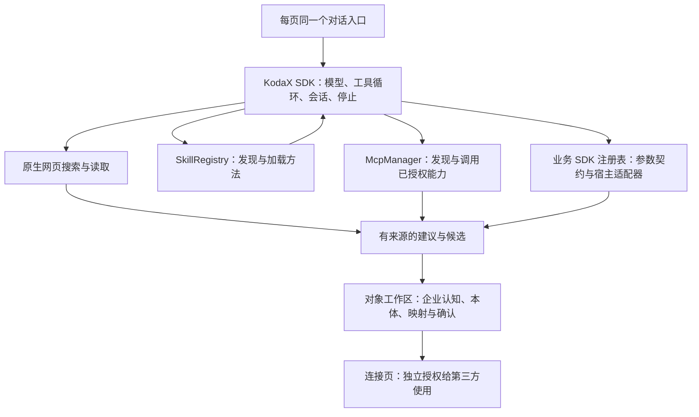

# Agent 通用能力（FEATURE_011）

DataEngine 的同一个企业记忆 Agent 现在可以搜索公开信息、加载 Skill、使用 MCP 工具/资源/提示词，以及调用已注册的第三方 SDK。四页和各页单一上下文保持不变。

## 怎么体验

启动 `npm run live:demo`，使用终端提供的本机 8796 链接。顶部“模型设置”配置模型；“能力”查看和管理可用能力。公开搜索使用 KodaX 原生默认检索，不需要另填搜索密钥。

可在对话里尝试：

- “搜索并阅读 KodaX 的官方资料，注明出处。”
- “使用 enterprise-research 方法帮我核查企业信息。”
- “用业务 SDK 查询 icetomoyo/KodaX 仓库的信息。”
- 在“能力 → 连接 MCP 服务”输入名称 `heating-callbacks` 和地址 `http://127.0.0.1:8802/mcp`，连接后勾选 `list_callbacks` 并保存，再问：“通过 MCP 查看最新回访结果。”已有同名连接可直接使用。演示源只包含虚构业务数据。

MCP 配置支持 Streamable HTTP 与 SSE，远程要求 HTTPS，本机允许 HTTP。请求头中的凭据只存本机 `capabilities/mcp.json`（0600），不放进能力目录和模型提示。具体工具需要用户选择后才开放；撤销全部立即阻止新调用及正在返回的结果。“重新发现”清空旧授权，再读取新目录；“断开连接”移除配置。当前未实现 stdio 配置界面和 OAuth 登录流程。

## 两类 SDK 如何结合

固定 KodaX SDK `0.7.96-beta.2`。Skill 和 MCP 使用 SDK 原有组件，不重新实现模型运行循环。NOOA 仍作为对象工作区的设计参考，没有宣称接入完整 NOOA Runtime。

- `src/agent/runtime.ts` 为四页开放原生 `web_search`、`web_fetch` 和五个 `mcp_*` 入口；完整目录 snapshot 由 SDK 分页。搜索和网页读取只记录工具名称，不向页面事件写入原始结果。
- `src/capabilities/skills.ts` 使用独立 SkillRegistry，只扫描本产品目录。`skill_use` 加载方法，Agent 随后用实际工具执行。自带企业研究、本体建模两项方法；支持加载新的 SKILL.md、包内参考文本。当前不执行动态 shell、hooks、fork 或 Skill 脚本。
- `src/capabilities/mcp.ts` 维护独立 MCP Manager 和具体能力授权。工具、资源和提示词都可被发现；结果按需读取，不写入企业记录库。配置变化在结果返回前再次检查。目录刷新期间不能新授权，刷新后旧设置页的版本不能重新授权；撤销不等待刷新。
- `src/capabilities/sdk.ts` 提供 `id / description / schema / execute` 的可信宿主注册接口。首个真实适配器为 `@octokit/rest@22.0.1` 的公开仓库读取。接某个企业 SDK 时，由开发者安装依赖、持有凭据并注册确定的方法；不是让模型任意安装 npm 包或执行代码。目前尚无用户指定的企业私有 SDK 适配器。

Agent 的通用 MCP、第二页的业务来源映射、第四页的对外访问范围是三个不同用途。发现/调用外部工具不会自动登记本体来源或开放第三方权限。结果仍要经过有来源的企业建议、本体候选和用户采用；不能把搜索内容当成用户确认事实。

## 实际验证（2026-09-09）

- 类型检查和 82 项回归测试通过，其中 7 项新增能力测试。覆盖真实 MCP 传输、跨 40 项目录发现、资源/提示词、撤销与在途调用、配置重启、Skill 安装和加载、Octokit 的实际请求路径及四页 Agent 工具接入。
- 隔离临时工作区中真实 KodaX / DeepSeek 运行完成 `capability_search → skill_use → mcp_search/mcp_describe/mcp_call → sdk_call`；SDK 返回 `icetomoyo/KodaX`，模拟回访返回 `未改善`。没有改动正式企业记忆。
- 原生 `web_search` 和 `web_fetch` 的实际事件及工具结果另行核实：搜索返回 5 条泛 GitHub 结果，未命中目标；读取指定仓库返回 HTTP 200，但页面超过 SDK 的 512 KiB 上限，结果标为不完整。能力已接通，不代表检索质量或长页面完整性已经解决。模型如实说明这些限制。
- 1280px / 390px 浏览器检查能力设置、MCP 连接和授权，无横向溢出。保留原四页及前景输入框。Skill 的加载、重启和拒绝无效内容通过后端验证。
- 新工具保持页面会话临时运行；不向旧的持久任务开放外部能力。会话关闭清理沿用 KodaX ephemeral 处理，模型回复中主动引用的内容仍遵循原有有界聊天保留逻辑。

本轮没有发布公网服务。检索质量、具体企业 SDK、OAuth/stdio、脚本沙箱与后台自主演变属于后续能力，不能因通用入口接通就标为已完成。

## 独立代码评审

Standards 轴：首次发现目录提前截断，后续发现刷新与授权并发竞态；分别用完整目录 snapshot、刷新锁与授权版本校验修复。Spec 轴：发现同一目录问题，修复后复验通过。回归包括 48 项目录跨服务筛选、刷新中授权拒绝、旧目录版本拒绝。
