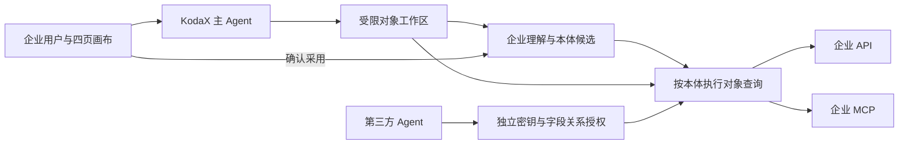

# API/MCP 企业记忆：运行与验收

2026-09-09 · FEATURE_010 · v0.1.0 开发版，尚未发布。

## 已实现的链路

同一个 KodaX 主 Agent 在四个页面内工作，使用受限的企业对象工具。NOOA 提供对象环境的设计参考，没有接入完整 NOOA Runtime。



来源端数据不整体导入 DataEngine。连接记录保存地址、批准的能力、字段/过滤/分页契约；本体保存业务定义及映射。每次查询实际调用原系统，返回读取时间和覆盖范围。无全量后台同步、跨源原子快照或远端历史回放。

建模时少量源样本进入模型上下文；画布运行结束后删除对应 SDK 临时会话。页面保留有界用户/助手对话，助手的业务说明可能引用样本。持久对象库不保存原始记录数组，业务定义和来源引用独立于对话保存。进程异常退出时 SDK 会话残留的恢复清理、主机磁盘加密、组织数据保留政策仍需在生产部署前补齐。

## 立即体验

```sh
npm ci
npm run live:demo
```

打开终端输出的 8796 管理链接。企业信息和来源已配置，本体首次启动为待确认候选；保存状态位于 `local-state/live-heating`，重复启动不会清空。

- 8801：独立的虚构热力投诉 HTTP API。
- 8802：独立的虚构热力回访 MCP Streamable HTTP。
- 8796：实际 DataEngine，连接两个来源，使用正常的 KodaX 驱动。查看和确认无需模型调用；聊天沿用已配置模型凭据。
- 本体页查看投诉 TS002 和回访 HF002；办结只表示工单流程结束，回访“未改善”是另一条事实。
- 点击“采用本体”，在连接页按字段创建范围，再点“启用以上范围”；密钥只在独立窗口交付一次。
- 在运行终端输入 `improved`，源系统的回访变为“已改善”；重新查询看到新值。本体、授权和密钥保持不变。输入 `unchanged` 恢复。模拟源记录只保存在模拟服务进程内，重启恢复初值。

原 `npm run demo` 的 8794 文件演示和 `npm run export:html` 离线 HTML 保留；它们不是来源连接的测试入口。

从空白企业开始仍使用 `npm start`（8788）。连接实际系统时，通过第二页“连接 API / MCP”配置来源，向 Agent 说明业务问题，由它读取样本并提出本体。采用与授权仍由用户完成。

## 支持的来源契约

HTTP：明确批准的同一源 GET 路径，返回 JSON；MCP：Streamable HTTP 的明确批准 tool，返回 structuredContent 或 JSON text。源接口需支持声明的分页和过滤，当前仅映射标量字段。不是任意 REST/OpenAPI 的自动适配器；不支持游标分页、任意请求体、写操作、OAuth、腾讯文档等专用连接器。

示例只读能力：

```json
[{
  "name": "list_callbacks",
  "fields": ["id", "complaintId", "outcome"],
  "idField": "id",
  "idType": "string",
  "itemsPath": "items",
  "totalPath": "total",
  "filters": {"id": "id", "complaintId": "complaintId"},
  "limitParam": "limit",
  "offsetParam": "offset"
}]
```

HTTP 能力另加 `path`，例如 `/callbacks`；MCP 的 `name` 必须为真实工具名。数字身份指定 `idType: "number"`，默认 string。`itemsPath` 可为空表示根数组，点分隔表示嵌套属性。`totalPath` 可省略，此时总量未知，不能将当前页当全量。过滤键是源字段，值是请求参数。关系目标必须支持关联字段过滤。

远端来源要求 HTTPS，本机实验允许 HTTP。只接受不含凭据、查询和片段的源地址；不跟随重定向；请求限时 12 秒，每次最多 100 条、响应最多 2 MB。MCP 工具输入结构发生变化、字段缺失、身份错误、过滤/分页不符或连接停用均失败。工具标注 readOnlyHint 本身不构成批准，管理配置里的能力清单才是调用边界。

来源密钥单独存放在本机权限 0600 文件，不进入领域工具或本体；目前为本机文件保护，不是集中密钥管理服务。连接停用后，引用它的本体不能继续查询。修改接口契约的操作路径是配置新连接、让 Agent 提出修订候选，确认后为需要迁移的应用重新授权；没有自动恢复或静默迁移旧授权。

## 第三方接入

每个调用方明确授予类型、字段（含 `$id`）及关系。关系的两个端点和关联字段都必须获准。未授权字段不出现在查询结果；来源地址和映射不对消费方暴露。管理员入口与消费密钥独立。服务当前仅监听本机，没有配置公网托管。

- `GET /v2/schema`：当前调用方可用的业务结构与按需读取语义。
- `GET /v2/objects?type=...&id=...&relation=...&fields=...&offset=0&limit=20`：获准的对象或关系。
- `Authorization: Bearer <连接页交付的 de_live_ 密钥>`。
- MCP 使用 `scripts/dataengine-mcp.ts`，环境变量 `DATAENGINE_URL` 为服务 origin，`DATAENGINE_CONSUMER_KEY` 为本调用方密钥。`describe_memory` / `query_objects` 通过同一授权查询。桥接按 de_live_ 与原 de_consumer_ 密钥分别选择 /v2 与 /v1。

授权绑定采用时的本体版本，源记录可变化。返回 `readAt` 说明读取时刻；两次查询可读到不同记录，不提供旧文件接口的 `dataVersion` 固定快照。返回值不是全局事务视图。停用绕过正在运行的 Agent 和管理请求队列；已经在途的结果在返回前重新检查授权和来源状态。

## Agent 工具

- `live_overview`：发现连接能力、本体和调用范围。
- `live_read`：读取实际源样本。
- `live_propose`：校验映射，保存本体候选与检查时间；不保存样本数组。
- `live_query`：执行对象及关系查询。
- `live_consumer_propose`：提出待启用的调用范围。

这些工具只在画布相应页面可用，普通历史任务不能调用。`live_propose` 和 `live_consumer_propose` 的保存复用运行身份校验及幂等写入；停止后的迟到操作不能保存。Agent 无采用、签发密钥或任意代码执行工具。结构检查不等于语义正确，rationale 保存业务解释与待确认内容，用户可查看具体映射再采用。

## 实测与边界

`npm run check`：类型检查和 75 项测试通过；新增 8 项覆盖实际 HTTP/MCP、不同源的关系、同密钥新事实、重启、越权、撤销竞态、数值身份、末页空结果及源契约错误。HTML 导出仍通过。

真实模型验收：在隔离目录中使用真实 KodaX + DeepSeek，执行 live_overview → 两次 live_read → live_propose，形成投诉/回访两个类型和编号关联；模型未采用候选。临时会话清理正常。此单案例不代表业务准确率评测。

浏览器：样本读取、关系图、对象、关联回访、来源字段映射、采用、访问范围、启用和凭据关闭；桌面与 390px 窄屏检查。程序测试另外通过真正的第三方 MCP 客户端验证当前源数据与权限。评审 Standards / Spec 两轴发现的问题已修复并复核。

本轮完成本地正式连接链路，不宣称已经具备企业多租户、SSO、记录级权限、集中密钥管理、完整故障恢复或生产部署。自动巡检/本体演变与方法对照按 FEATURE_004/006 后续开展；当前源变化可在下一次读取中体现，接口变化需要检查和人工确认修订。
