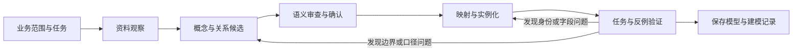

# 本体建模流程设计：MVP草案

本轮目标是设计并验证产品中的本体建模能力：输入企业业务目标和可见资料，经过有依据的分析、候选设计、确认和验证，形成可复用的企业语义模型。当前只用热力案例跑通这套流程，采用一个建模Agent、少量数据工具和文件记录。

此前两次模型调用生成的9类对象、738个实例保留为技术试样。它验证了候选JSON到对象与来源引用的实现路径，尚未验证概念选择、业务边界和建模过程合理；撤回对该试样直接保存正式v1的确认请求。

## 先明确要验证什么

本体建模能力需要回答三个问题：

1. 为什么企业需要这些概念、关系和口径，证据和业务用途是什么？
2. 概念怎样落到不同来源的记录上，遇到别称、时间差、缺失或冲突怎样处理？
3. 模型能否支持预定业务任务与新的任务组合，哪些判断仍然不能做？

对象数量、关系数量、JSON校验及导入成功属于技术检查。业务模型还须经过任务、概念边界与反例检查；方法收益仍需后续公平对照。

## 产品内的最小流程

| 阶段 | 具体工作 | 最小产物 | 进入下一步的依据 |
|---|---|---|---|
| 1. 业务范围与任务 | 说明谁使用、处理什么工作、要作出什么判断；选3—5个公开建模问题，列出本轮不处理的业务 | 一页建模任务说明 | 任务明确，来源范围可获得，没有把留出评分题当建模需求 |
| 2. 资料观察 | 查看系统职责、字段、样例、文档效力、时间与数据质量；整理同名异义、别称和跨源关联线索 | 来源清单及问题记录 | 能区分已知事实、有效规则、讨论意见与资料缺口 |
| 3. 概念与关系候选 | 按业务含义、稳定身份、生命周期和任务需要划分概念；说明属性、关系、状态与规则 | 少量概念卡、关系图和口径卡 | 每个候选有用途和来源，关键粒度选择有理由；未决问题显式保留 |
| 4. 语义审查与确认 | 检查概念重叠、范围外推、关系含义、指标口径；对确有分歧或影响较大的定义让用户选择 | 决策记录及修订候选 | 关键业务定义有明确决定；来源不足部分保留边界，不靠确认一句话填补证据 |
| 5. 映射与实例化 | 将源记录联系到已设计概念，处理主键、别称、时间有效性、单位及缺失；保留证据 | Mapping、少量实例和未解析项 | 实例符合身份与关系约束，能定位源记录，不强行补全未知关系 |
| 6. 任务与反例验证 | 沿真实数据路径回答公开任务，检查定义是否够用，并尝试会导致误判的情况 | 验证记录、失败原因和修改项 | 能说明哪些任务可完成、哪些仍不能判断；区分概念设计问题、映射问题和数据不足 |

这是本项目的拟定工作流程，尚未按六个阶段完整执行过，不能把这份设计文档本身计为流程验证完成。

## 概念怎么设计

概念粒度由业务身份、生命周期和用途共同决定。一张表可以为多个概念提供信息，一个概念也可以由多种来源共同支撑。保留源表来源关系，不强制“每表一个类型”或“每行一个业务实体”。

每张概念卡只需写清六项：

- 名称与定义：业务中代表什么，明确包含和排除的范围。
- 身份与时间：凭什么判断是同一个对象，哪些属性变化不改变身份，状态何时有效。
- 属性与关系：哪些是自身属性，哪些需要独立对象；关系方向、数量及成立条件。
- 任务用途：它帮助完成哪个业务判断，哪些新问题可以复用。
- 来源与构造条件：哪些记录或文档支持它，建立实例需要哪些证据。
- 未决选择：粒度或边界存在分歧时，列出备选与影响，而非只给一个答案让人盖章。

热力案例首先需要研究这些设计问题，以下不是已经定稿的本体：

| 设计问题 | 需要作出的业务判断 |
|---|---|
| 换热站与监测标签 | 站点身份如何保持稳定；接入标签和有效时间应作为映射依据还是业务对象 |
| 投诉单与异常事件 | 多次来电怎样独立保留；是否需要事件概念；什么证据能将投诉关联到某次事件 |
| 房屋、住户与投诉地址 | 当前资料支持哪个粒度；地址文字是否足以认定同一房屋或住户；缺少身份信息怎样保留 |
| 站点读数与入户测温 | 是否需要共同的观测概念及不同测量对象，还是采用分别定义；单位、位置和时间怎样限制结论 |
| 办结、维修完成与恢复 | 分别是谁的状态；需要怎样的证据才能判定对应范围内恢复 |

即使没有“异常事件表”，也可以依据业务任务和日志提出事件概念；是否建立事件实例、如何归并来电，需要另外的构造与确认依据。没有足够证据时保留候选或未知关系，不把概念存在等同于具体事件已被证实。

## Agent、程序和人各做什么

**建模Agent**读取资料、解释业务术语、提出概念和粒度备选、寻找冲突、给出映射建议，再依据验证结果修订。阶段之间保存中间结果，不能仅以一次长提示直接输出最终对象包来代替这些判断。

**程序工具**负责来源读取/画像、字段与引文检查、实例生成、精确计算和约束检查。程序能检查引用是否存在、身份是否唯一、日期是否越界；“一条证据能否支持这项业务定义”还需要语义复核。

**用户/业务负责人**确认业务范围以及确有歧义、会改变业务判断的关键定义。系统应展示具体备选、依据和影响，集中处理少量关键决定。已有明确有效规则可以作为候选依据，不需要为每个字段增加审批。

一个Agent顺序执行上述步骤即可，无须为每一步建立独立Agent或调度平台。来源读取可复用现有工具，当前对象导入原型可作为第5阶段的起点；维护Runtime继续沿既有FEATURE_003计划接入。

## 第一轮怎样执行

从“投诉处理与异常复盘”这一条业务链起步。先写建模任务说明，沿公开业务问题挑选最小代表性资料；随后产出概念卡和关键粒度备选，完成语义审查，再修订Mapping并建立少量实例。

第一轮主要检查：

- 一条投诉怎样联系到服务设施、处理记录和后续反馈，各条关系分别说明什么。
- 如何区分客服流程关闭、设备处理结束、站内工况改善与住户反馈。
- 重复来电、同站不同问题、未接通回访、缺失监测和晚录入记录能否得到有边界的解释。
- 增加一个当前公开建模任务未直接覆盖的新组合问题时，已有概念能复用到什么程度。

先验证一条链及其反例，再覆盖完整样本。冻结留出题及评分答案不能进入建模Agent输入或用于针对性修订；方法评测仍按原计划保留对照和已披露的独立性限制。

## 最小实现与验收边界

先用一份建模任务说明和一个建模记录JSON保存各阶段输入、输出、来源版本、选择理由、未决项和验证结果。概念/关系/口径卡可放在同一候选文件，Mapping独立保存。不增加图数据库、正式逻辑推理器、复杂流程引擎或本体编辑器。

沿既有“来源与候选输入 → 对象/关系/证据输出”公共边界验收，并补充同一业务任务的语义检查。此前18项测试可以保留，但它们不能作为建模流程质量的充分证据。每次语义审查说明审查者、发现和修改；助手复核不得标作独立人工确认。

T002-01 只有在建模流程实际执行、设计理由与关键决定有记录、实例能够支撑任务且边界可验证后，才具备保存正式v1的条件。T002-02负责最终可调用的计算函数和MCP接入；本阶段先设计所需函数契约并用最小检查验证其业务口径。

## 现有试样的处理

保留候选、对象预览、两次模型调用和来源追溯代码，作为可复用的技术试样；不删除历史、不改写调用结果、不发布为正式本体。此前“最多10类、每表一个类型”等抽取提示只描述那次试验，不作为新的概念建模规则。

当前先完成建模流程与任务说明的设计，再运行该流程。撤销“只剩批准9类对象和两个公式”的进度判断；T002-01继续InProgress，当前不请求用户批准旧试样。
