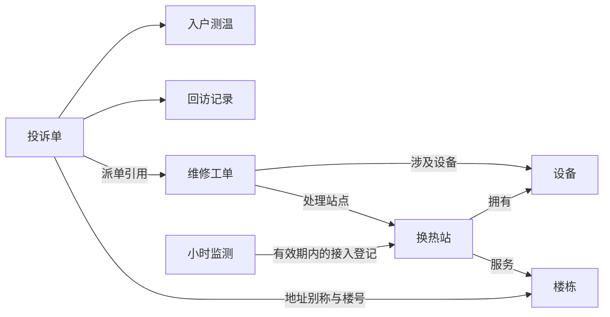

# 初始本体 v1 候选：确认摘要

状态：**候选和对象预览已生成、已验证，尚未确认为正式 v1。** 使用澄川热力截至 2026-01-19 00:00（UTC+08:00）的18份可见来源；不使用未来制度、生成器内部历史或评测答案作为抽取输入。

## 这一版怎样理解企业

| 对象 | 数量 | 表达什么 |
|---|---:|---|
| 换热站 | 2 | 供热服务设施的稳定身份 |
| 楼栋 | 12 | 站点服务的楼栋，保留正式小区名和楼号 |
| 设备 | 6 | 台账设备及其所属站点 |
| 投诉单 | 10 | 每次独立登记的来电/投诉，不按相同地址合并 |
| 维修工单 | 4 | 派单、处理状态及现场记录 |
| 回访记录 | 10 | 每次反馈单独保存，支持判断最近一次结果 |
| 入户测温 | 8 | 指定住户位置与时间的实测值 |
| 小时监测 | 672 | 站点小时区间的运行记录，缺失保留为空 |
| 日气象 | 14 | 日均气温背景，不推断小时气温 |

共738个对象。接入登记表用于解释标签身份，不额外造一套站点对象。暂不建立没有直接来源实例的住户、根因或故障事件对象。

9类关系共731条连接。日气象暂作为独立观测，不凭“同一天”编造因果关系。

## 要确认的业务口径

1. **客服办结率**：统计窗口内收到的投诉中，截至查询时点已关闭的条数 ÷ 该窗口投诉总条数。
2. **回访确认改善率**：同一投诉集合中，最近一次回访明确改善的投诉条数 ÷ 有回访结果的投诉条数。未接通和其他/不确定计入分母；没有回访记录的投诉另列，不计入该分母。

二者均采用已批准的 [投诉处理与周复盘口径](../../data/samples/chengchuan-heating/sources/company/service-rules.md)：窗口左闭右开；查询时点不早于窗口结束；分母为零返回“无样本”。窗口结束后的关闭/回访，若在查询时点前已经可见，可以用于判断该窗口投诉的状态。

**办结、回访改善、设备处理完成、站内运行恢复是不同事实。** 不把它们统一命名为“恢复率”，不据少量测温推断全部住户恢复。工单引用仅表示派单安排，不确认投诉具有同一根因。

## 已经能检查的对象实例

`Ticket:CS-009` 保留原始地址“松园3号楼102”，通过地址说明与楼号联系到 `Building:SY-03`；该楼栋由 `Station:Z01` 服务。同一投诉还能联系到维修工单和回访记录。每一步都有原始记录编号、文件哈希与映射依据。

本批10条投诉地址均有唯一楼栋匹配。另有8项“没有匹配记录”：2项缺少回访、6项缺少测温，均与当前来源一致；它们不是8条已修复关系，也不会生成虚构回访或测温。缺失的原始数值同样保持null，不填0。

## 候选怎样得到

实际调用模型两次：首轮抽取，再根据来源字段和原文校验反馈修订。首轮把小时监测映射方向写反，程序检测出不存在的字段；修订补齐方向、地址简称、站点引用和规则引文。

第二次模型输出仍保留旧关系名称与几个来源已经解释的疑问，本次开发助手做了明确登记的整理：统一关系方向命名，删除重复疑问，将待确认项限定为对象粒度和上述两项口径。候选不是零人工干预的自动抽取结果。实际输入/输出及用量存于本地运行记录，版本化来源说明见 [provenance-v1.json](../../config/ontology/provenance-v1.json)。

本次作者助手曾接触基线结果，不能充当独立盲测建模者；两次实际抽取请求只包含可见来源、建模契约和来源校验反馈，未发送基线题库、答案或得分。此轮证明候选到对象的路径可运行，不证明本体必要性或模型独立建模质量。

确认范围是**这9类对象及关系含义、正式规则中的两项业务口径**。确认后才把相同候选与当前快照保存为正式v1；指标计算函数和MCP消费在T002-02实现。本摘要与可运行预览均已准备好，不需要先建设前端才能确认。
