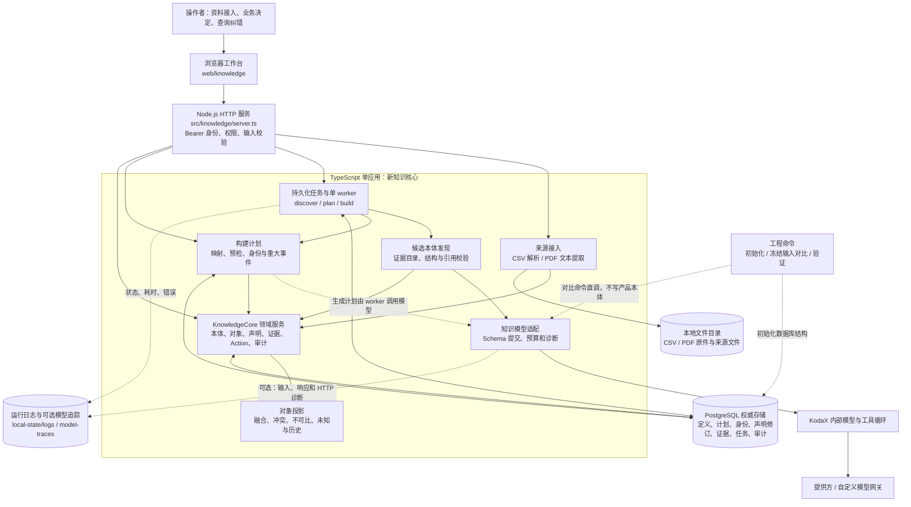
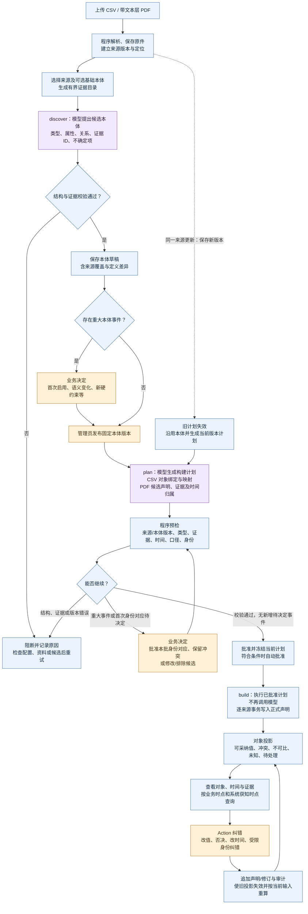
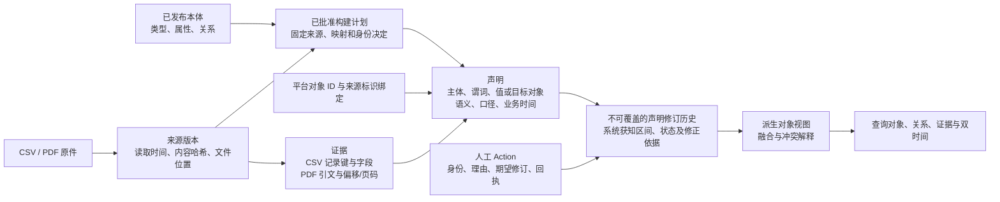

# Context OS 当前实现架构与流程

观察日期：2026-11-03。范围：当前工作区的新知识核心（`npm start`），包括尚未发布的改动。本文是代码现状说明，不新增需求、不替代第一阶段决定，也不代表完整业务效果验收通过。

## 1. 整体架构

- 前端负责交互，不直接写数据库；服务端负责授权、事务、版本与回执。
- KodaX 是内部模型/工具循环；模型提出结构化候选，不能绕过领域服务直接修改事实。
- 模型调用不在数据库事务锁中等待。任务、计划、知识写入有各自的幂等与并发校验。
- PostgreSQL 是新知识核心的权威存储；本地目录保存原件及日志，不作为另一份可独立修改的事实库。
- 图中的模块是同一个应用里的职责划分，不是多个微服务。

### 仓库入口边界

| 命令 | 入口及用途 | 与新知识核心的关系 |
|---|---|---|
| `npm start` / `knowledge:start` | `src/knowledge/server.ts`，默认本机 3211 | 当前主流程 |
| `knowledge:init` | `scripts/knowledge/database.ts` | 显式初始化 PostgreSQL 结构 |
| `knowledge:compare` | `scripts/knowledge/compare-discovery.ts` | 独立性能/生成实验，不等于正式发布与构建 |
| `legacy:start` | `src/agent/server.ts` | 保留的旧应用服务，不是新核心必经环节 |
| `mcp` | `scripts/context-os-mcp.ts` | 仓库既有 MCP 入口，不能据其存在宣称新核心全部能力已通过 MCP 接入 |

旧实现中的 SQLite、旧发布消费流程与新 PostgreSQL 核心是不同接入事实。外部 Agent 消费是产品方向；本图不把旧接口画成新核心已经完成的统一入口。

## 2. 从资料到可查询知识的流转

蓝色为程序处理，紫色为模型调用，橙色为业务决定。失败回执与待决定状态不等于完成。

补充实际入口差异：

1. “仅生成计划”可以先针对草稿运行；正式批准和执行需要已发布的同内容本体。上图为便于讲解，画的是先发布再构建的主线。
2. “开始构建知识”针对已发布本体，可将 plan → 预检 → 批准 → build 串成后台续接任务；重大事件未解决时暂停，不把任务提交等同构建成功。
3. 编辑草稿或计划后需重新检查受影响的事件/预检。已批准且未变化的身份绑定可按当前规则延续；新对应需明确决定，不是任意模糊匹配。
4. 金额冲突可以保留，不要求强行选出赢家；缺失口径和未知时间不能靠猜测补齐。哪些冲突参与重大事件由当前可比性和有效期规则决定。
5. 普通绑定自动校验，当前代码已改为重大事件集中决定；此前“每个成员逐项确认”的手动说明属于旧交互，不应当作当前流程的必经步骤。
6. 模型生成的 PDF 声明在 plan 阶段产生，build 使用冻结输出。上传 PDF 的文本解析不由模型完成，不要求多模态模型。

## 3. 一条知识怎样追溯到原始资料

例如同一合同的 CSV 金额和 PDF 金额是两条各有依据的声明。身份批准把它们关联到同一个平台对象，投影保留或解释争议，不能覆盖原始文件。事实纠错追加历史，不是训练模型；本体与计划的规则变化需单独治理。

## 4. 代码位置与职责

| 层次 | 当前代码 | 说明 |
|---|---|---|
| 工作台 | `web/knowledge/index.html`、`app.js`、`plans.js` | 资料、任务、本体、重大事件、计划与对象查询 |
| HTTP 边界 | `src/knowledge/server.ts` | 身份、权限、参数校验、API 与静态页面 |
| 通用契约 | `src/knowledge/contracts.ts`、`build-contracts.ts` | 定义数据结构和运行时校验，不是“业务合同”专用代码 |
| 来源 | `src/knowledge/sources.ts`、`src/data/document-files.ts` | CSV、PDF 文本解析、保存与证据定位 |
| 本体发现 | `src/knowledge/discovery.ts` | 程序建立证据目录，校验模型引用，分类不确定项与重大事件 |
| 模型任务调度 | `src/knowledge/jobs.ts` | PostgreSQL 任务、单 worker、租约、幂等、后台续接 |
| 模型适配与循环 | `src/knowledge/model.ts`、`src/agent/runtime.ts` | 结构化提交、KodaX 循环与模型运行预算 |
| 模型传输保护 | `src/agent/custom-provider.ts`、`src/observability/model-transport.ts` | custom HTTP 边界、失败重发拦截、断流和总预算、明确推理参数 |
| 计划与预检 | `src/knowledge/build-plans.ts`、`build-mapping.ts`、`build-events.ts` | CSV 多对象/双端点映射、时间、身份、冲突与批准 |
| 领域操作 | `src/knowledge/service.ts`、`identity.ts` | 本体发布、对象、声明修订、证据、Action、审计 |
| 对象投影 | `src/knowledge/projection.ts` | 根据声明计算展示结果，不等同 OWL 逻辑推理 |
| 存储 | `src/knowledge/database.ts`、`sql/001`—`005` | PostgreSQL 事务与版本化结构 |
| 可观测性 | `src/observability/logger.ts`、`model-trace.ts`、`model-http-trace.ts` | 轮转日志、可选原文与 HTTP 追踪、逐轮用量 |

## 5. 对外讲解的准确边界

当前是对象式语义模型＋声明/证据/双时间治理，使用 PostgreSQL 和 JSON 定义；未直接采用 RDF 存储、OWL 推理、SHACL 验证或 SPARQL 查询。当前主要输入是 CSV 和带文本层 PDF，数据库连接器大规模接入、OCR、多模态、通用自动推理、生产级多租户/高可用不能画成已实现。

图按源码调用关系整理，未发起模型调用或数据库写入，也未因生成文档宣称新的运行验收通过。后续代码变化应更新此现状说明；设计目标和正式验收仍分别以实施决定和运行记录为准。
